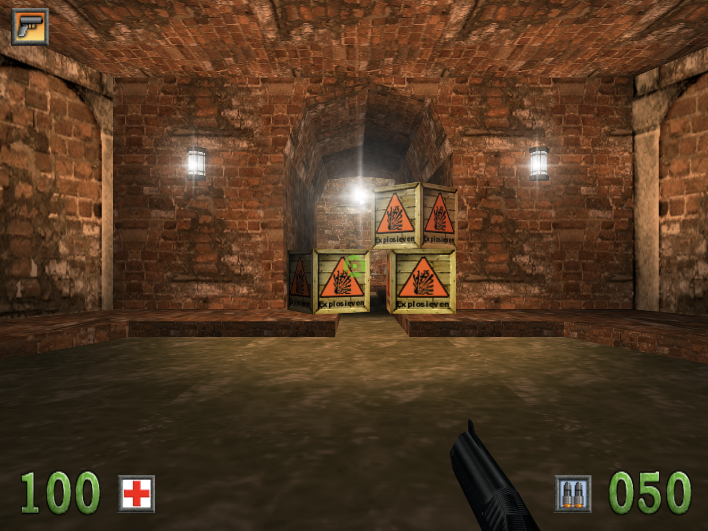
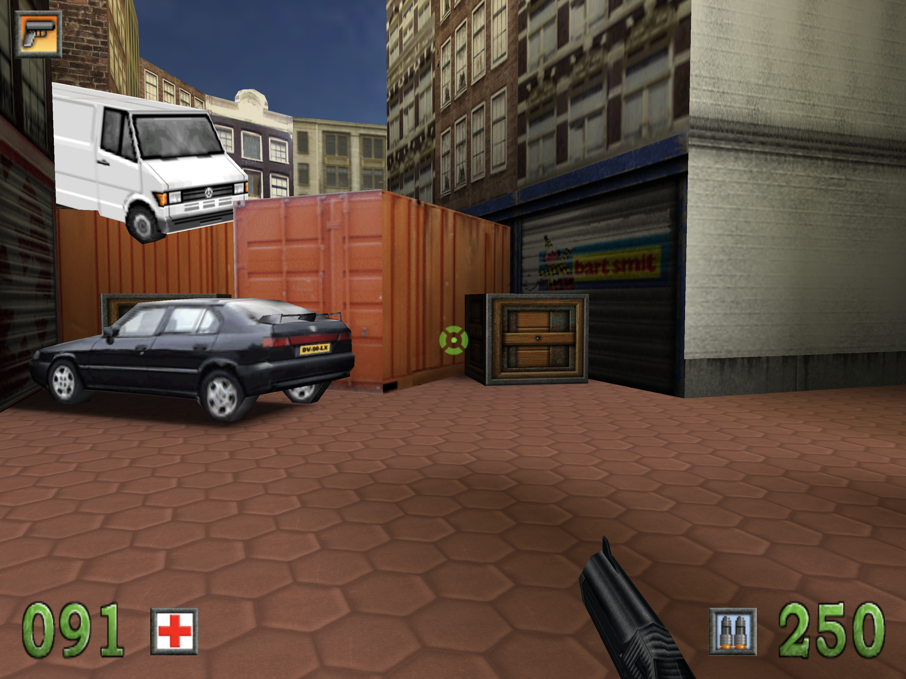

# Amsterdoom — Linux port (Steam Deck)

Play **Amsterdoom** (the Dutch first-person shooter from 2000, set in Amsterdam) on a Steam Deck
or another Linux PC.

<p>
  
  
</p>

This repository contains only the **port**: the game program rebuilt for current Linux
(`Amsterdoom.AppImage`, 64-bit, OpenGL). It contains **none of the game's files** (levels,
graphics, sounds, music, the intro film). To play, you need **your own copy of Amsterdoom**: the
original CD, or a folder where the game is installed.

## Playing

1. Download `Amsterdoom.AppImage` (see [Getting it](#getting-it) below) and start it. A start
   screen opens.
2. Read in the game, in one of two ways:
    - **Cd inlezen / Read in the CD**: put the Amsterdoom CD in the drive (on the Steam Deck: a
      USB CD drive; a USB stick or SD card with a copy of the CD or of the installed game is fine
      too, as is a mounted image of the CD). The screen finds it by itself; below the button it
      shows what it found.
    - **Kies de cd-map… / Choose the CD folder…**: choose the folder of your Amsterdoom CD, or
      the folder the game is installed in, in the screen's own folder list (it works with the
      touchscreen, a mouse or the controller). **Schijven / Drives** shows the CDs, USB sticks
      and SD cards. The program finds the game in the chosen folder by itself (it looks for
      `Adamwin.ini`, which on the CD is in `Target Files`).

    The files are copied to `~/.local/share/Amsterdoom/GameData` on this computer. **They are
    not uploaded or sent anywhere.** Reading in takes from a few seconds to a few minutes from a
    CD (around 220 MB).
3. Click **Klik om te spelen** (or press Enter, or A on the controller). The game starts
   fullscreen.

On later starts the start screen shows **Klik om te spelen** straight away; the CD is no longer
needed. Saved players are kept in `~/.local/share/Amsterdoom/Amsterdoom/`. To remove the game
files, use the link on the start screen ("remove the game files from this computer"); your saved
players stay.

The game is in Dutch. It shows the game's 4:3 picture as large as the screen allows, with black
bars at the sides on wide displays (the Steam Deck's too). In the menu, **Opties → Weergave**
lowers the 3D resolution if a computer is too slow.

## Getting it

**Requirements:** a Steam Deck (SteamOS 3), or a 64-bit x86 Linux PC from the last years
(glibc 2.35 or later: Ubuntu 22.04, Debian 12, Fedora 36 or later, Arch, and the like) with an
OpenGL 3.2 graphics driver (Mesa or NVIDIA's). Nothing needs to be installed: SDL2 is packed
into the AppImage.

### On the Steam Deck

1. Switch to **Desktop Mode** (Steam button → **Power → Switch to Desktop**).
2. Open this page in the browser, click **Amsterdoom.AppImage**, then the download button
   (**Download raw file**). Move the file somewhere it can stay, for example to a new folder
   `Games` in your home folder.
3. In the file manager (Dolphin), right-click the file → **Properties → Permissions**, tick
   **Is executable**, and click **OK**.
4. Right-click the file again → **Add to Steam**. (Or in Steam: **Games → Add a Non-Steam Game
   to My Library… → Browse…**, choose the file and click **Add Selected Programs**.)
5. Switch back to Gaming Mode (the **Return to Gaming Mode** icon on the desktop). Amsterdoom is
   in your library under **Non-Steam**.

The first time, it is easiest to read in the game in Desktop Mode, where a USB CD drive or stick
is always mounted. After that, play from Gaming Mode; the Deck's controls work as a game
controller.

### On another Linux PC

- **With git**:

    ```sh
    git clone https://github.com/DavidStolk/amsterdoom-linux-port.git
    amsterdoom-linux-port/Amsterdoom.AppImage
    ```

- **As a download**: download `Amsterdoom.AppImage` from this page, make it executable (in the
  file manager under **Properties → Permissions**, or `chmod +x Amsterdoom.AppImage` in a
  terminal), and double-click it.

You can move the file anywhere. Options can be added after it, for example
`./Amsterdoom.AppImage --no-intro` to skip the intro film, or `--window 1280x960` to play in a
window. On the Steam Deck these go under the game's **Properties → Launch Options** in Steam.

## Controls

The original defaults; change them in the menu under **Opties → Besturing**.

**Game controller** (the Steam Deck's own controls, Xbox, PS5 and compatible) works too.

## Troubleshooting

- **The CD button stays grey ("no Amsterdoom CD found")**: wait until the CD shows up in the
  file manager; the button follows the drives by itself. In Gaming Mode a CD drive is not always
  mounted: read in the game once in Desktop Mode. Otherwise choose the CD with **Choose the CD
  folder…**.
- **"No Amsterdoom found in this folder"**: choose the CD itself, its `Target Files` folder, or
  the folder of the installed game. The game folder needs `Adamwin.ini`, `AdamWin.exe`,
  `AdamMenu.exe` and the `Levels` folder.
- **"Reading failed"**: a scratched CD, or too little free disk space (about 220 MB is needed).
  Try again, or copy the CD to a folder first and choose that.
- **Nothing happens when the file is double-clicked**: it is not executable yet; see
  [Getting it](#getting-it).
- **The game does not start, or the screen stays black**: the game writes what went wrong to
  `~/.local/share/Amsterdoom/log.txt`. On a PC, update the graphics driver.
- **The mouse does not turn**: click into the game. Esc releases the mouse again.
- **The in-game texts look different from the original**: the original game uses Windows'
  Times New Roman for them (the menu's own font is used without it). If you have your own copy
  of that font (`times.ttf`), put it in `~/.local/share/fonts`.

## Legal

Amsterdoom, its name, levels, graphics, sounds, music and film are the property of their rights
holders. This repository contains none of them; you need your own copy of the game to play.

The engine is **Genesis3D 1.0** (Genesis3D Public License, see `LICENSE-Genesis3D.txt`). Also
used: **SDL2** (zlib license), **pl_mpeg** (MIT license), **stb_truetype** (MIT license or public
domain), the **DejaVu Sans** font (for the start screen) and the **AppImage runtime**. Their
license texts are in `THIRD-PARTY-LICENSES.txt`.
